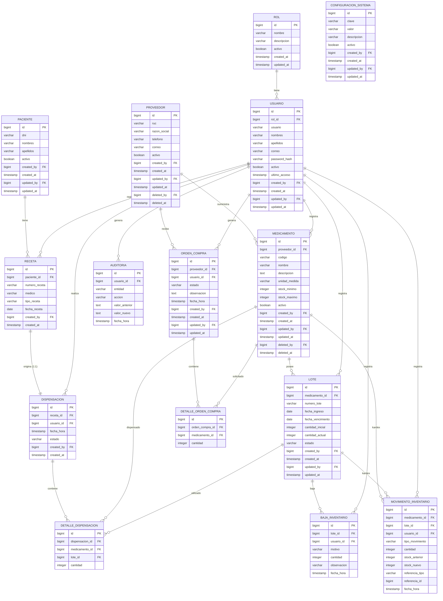

# FarmaMed – Modelo Entidad Relación (DER)

**Empresa:** Hospital Santa María del Socorro – Ica (Cat. II-1)
**Proyecto:** Sistema de Gestión Hospitalaria para Control de Caducidad, Inventario y Dispensación
**Motor:** PostgreSQL
**Autor:** Francisco Gabriel Berrocal Ramos

> Nota: `Farmamed-EDR-mermaid.png` está pendiente de regenerar con mermaid-cli (falla puppeteer/chrome en este equipo). Fuente de verdad es el bloque mermaid de este .md (ya incluye MOVIMIENTO_INVENTARIO y 1:1 Receta-Dispensación).

